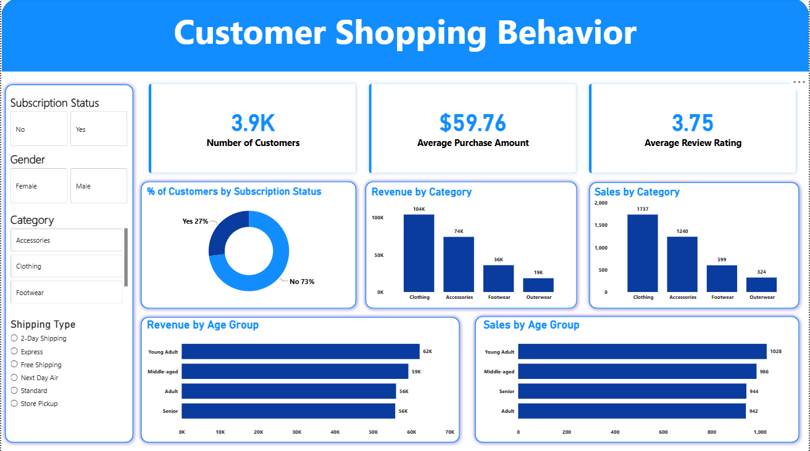

# 📊 Customer Shopping Behavior Analysis Dashboard

## 📌 Project Overview
This project provides an end-to-end retail data analysis and visualization solution for evaluating Customer Shopping Behavior, Revenue Drivers, Category Performance, and Demographic Segmentation. It helps analyze customer subscription adoption rates, age-group purchasing power, product category contributions, and overall retail KPIs (Average Purchase Amount, Order Sales, Customer Base) to support data-backed marketing strategies, inventory planning, and customer retention programs.

---

## 🎯 Objectives
- Analyze Retail KPIs: Evaluate overall customer base, average order purchase value, and review satisfaction ratings.
- Assess Subscription Adoption: Measure the ratio of subscribed versus non-subscribed customers to identify loyalty program opportunities.
- Segment Demographic Profiles: Track revenue distribution and sales volume across age demographics (Young Adult, Middle-aged, Adult, Senior).
- Evaluate Category Metrics: Identify top-performing product categories (Clothing, Accessories, Footwear, Outerwear) by revenue and order count.
- Generate Strategic Recommendations: Provide data-driven retail policies with clear numerical and percentage targets to boost customer lifetime value and subscription retention.

---

## 🛠️ Tools Used
- **Python** (Data Cleaning, Exploratory Data Analysis, and Statistical Validation)
- **SQL Server** (Data Extraction, Aggregation, Demographic Grouping, and KPI Validation)
- **Power BI** (Data Modeling, DAX Measures, Dynamic Tooltips, Interactive Slicers, UI Dashboard Design)

---

## 📐 Key Techniques Applied
- Complex SQL Aggregations & Grouping
- Advanced DAX Measure Calculations
- Dynamic Demographic & Slicer Cross-Filtering
- High-Contrast Retail UI/UX Visualization

---

## 📁 Dataset Overview
- **Total Customer Base:** 3,900 customers (3.9K)
- **Key Columns:** Customer ID, Age, Gender, Category, Purchase Amount ($), Location, Size, Color, Season, Review Rating, Subscription Status, Shipping Type, Discount Applied, Promo Code Used, Previous Purchases, Payment Method, Frequency of Purchases.

---

## 📈 Key Performance Indicators (KPIs)
- **Number of Customers:** 3.9K (3,900)
- **Average Purchase Amount:** $59.76
- **Average Review Rating:** 3.75 / 5.0
- **Total Revenue (Est.):** ~$233K ($233,064)

---

## 🔍 Key Insights & Findings

### 1. Subscription Status & Loyalty Adoption
- **Non-Subscribed Customers** dominate the customer base at **73%** (~2,847 customers).
- **Subscribed Customers** account for only **27%** (~1,053 customers), highlighting a significant opportunity to convert non-members into recurring loyalty programs.

### 2. Category Performance & Revenue Distribution
- **Clothing** is the primary revenue driver, generating **$104K (44.6% of total revenue)** across **1,737 sales orders**.
- **Accessories** rank second with **$74K (31.8% of total revenue)** across **1,240 sales orders**.
- **Footwear** contributes **$36K (15.5% of total revenue)** across **599 sales orders**.
- **Outerwear** accounts for the smallest share at **$19K (8.2% of total revenue)** across **324 sales orders**.

### 3. Demographic & Age Group Purchasing Patterns
- **Young Adults** generate the highest revenue at **$62K (26.6% share)** with **1,028 total orders**.
- **Middle-aged** customers follow closely with **$59K revenue (25.3% share)** and **986 orders**.
- **Adults** generate **$56K revenue (24.0% share)** with **942 orders**.
- **Seniors** contribute **$56K revenue (24.0% share)** with **944 orders**, displaying consistent and steady purchase volumes across all age brackets.

---

## 💡 Strategic & Actionable Recommendations

- **Increase Loyalty Program Conversions:** Convert non-subscribed users (currently **73%**) by offering a **10–15% first-purchase discount** upon joining the subscription membership to boost subscription rates past **35–40%**.
- **Cross-Sell Low-Performing Categories:** Pair low-volume categories like **Outerwear ($19K / 324 orders)** and **Footwear ($36K / 599 orders)** with high-performing **Clothing items ($104K)** through bundled discount promotions ("Buy Clothing, Get 20% Off Outerwear").
- **Target Young Adult Preferences:** Capitalize on the strong **Young Adult demographic ($62K revenue / 1,028 orders)** by expanding trend-focused digital marketing campaigns and personalized product recommendations.
- **Elevate Customer Satisfaction Ratings:** Address feedback channels to lift the **3.75 / 5.0 average review rating** to **4.2+** by offering post-purchase satisfaction surveys and instant support resolution for low-rated transactions.
- **Optimize Shipping & Fulfillment Channels:** Evaluate shipping type preferences (Express, Free Shipping, Store Pickup) to streamline fulfillment costs and improve checkout conversion rates.

---

## 👤 Author
**Rohit Kumar Singh**  
Customer Shopping Behavior Analysis

---

# 🖥️ Dashboard Views

Here is the interactive dashboard screen developed in Power BI for detailed shopping behavior analysis:

### 1. Shopping Behavior Overview Dashboard
*Provides a visual summary of overall KPIs, category revenue breakdowns, subscription shares, and demographic purchasing trends.*

